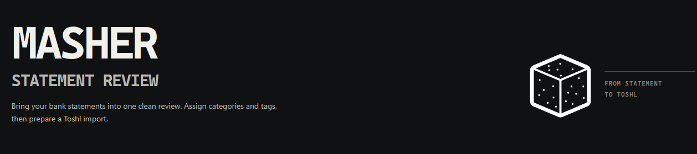

## Setup

1. Install [uv](https://docs.astral.sh/uv/getting-started/installation/) if it is not already installed.
2. Install the project dependencies and create the virtual environment:

   ```sh
   uv sync
   ```

The project requires Python 3.12 or newer. `uv` will use an installed compatible Python version or can install one with `uv python install 3.12`. `uv sync` installs the project package in editable mode for local module commands and UI imports.


## Usage

### Local WEB UI
Statement files are parsed locally and are not sent to a hosted service.

1. From the project root, install the optional Flask dependency and start the local server:

```sh
uv sync --extra ui
uv run python ui/server.py
```

2. Open <http://127.0.0.1:8765>. Upload either statement or both. The app parses, normalizes, and matches the files, then shows a paginated transaction sheet sorted newest-first by date. Sort by a column heading, adjust rows per page, and edit amounts, categories, tags, Toshl descriptions, or inclusion inline. Repeated normalized descriptions share a learned mapping. Each row can be included, omitted from the current export once, or omitted permanently from future runs.

3. Saving writes manual mappings and permanent omissions to the local JSON files selected under “Dates and local data files.” The app uses `masher.export_to_toshl` to prepare the Toshl import CSV. The reviewed and Toshl CSVs are offered as browser downloads and are not saved into the repository automatically.

4. The defaults are `data/toshl_categories_tags.json`, `data/mappings.json`, and `data/omitted_descriptions.json`. Stop the server with Ctrl+C.

### Manual 

Run these scripts directly to process statements and create a Toshl import CSV:

1. Parse the statement files, normalise descriptions, and match transactions. Provide either statement path or both; `masher.matcher` runs parsing and normalisation as part of this step.

   ```sh
   uv run python -m masher.matcher path/to/hdfc_statement.txt path/to/icici_statement.xls --export-to-csv
   ```

   The command prints the matched transactions and writes a timestamped `*_matched_statement.csv`. You can optionally filter dates with `--start-date DD/MM/YYYY --end-date DD/MM/YYYY`.

2. Review the matched CSV. By default, this saves your review and updates `data/mappings.json`:

   ```sh
   uv run python -m masher.reviewer YYYYMMDD_HHMMSS_matched_statement.csv
   ```

3. Export the reviewed CSV in Toshl's import format:

   ```sh
   uv run python -m masher.export_to_toshl YYYYMMDD_HHMMSS_matched_statement_reviewed.csv
   ```

The Toshl CSV is written beside the reviewed file. Run any script with `--help` to see its options.


## Refresh Toshl categories and tags

The sync script uses your Toshl API token to refresh the local category and tag list.
The account API token belongs in a local `.env` file in the project root. Start with the ignored template:

```sh
cp .env.expample .env
```

Edit `.env` and replace the placeholder with your token. `.env` is ignored by Git; do not commit it.

Preview the current categories, tags, and links without changing the taxonomy file:

```sh
uv run --env-file .env python scripts/sync_toshl_taxonomy.py --dry-run --output data/toshl_categories_tags.json
```

If the summary looks right, refresh `data/toshl_categories_tags.json` by running the same command without `--dry-run`:

```sh
uv run --env-file .env python scripts/sync_toshl_taxonomy.py --output data/toshl_categories_tags.json
```

The updater keeps category/tag IDs and names, rebuilds tag/category links, excludes Toshl's `unsorted` pseudo-category, and writes the taxonomy file atomically. It does not update `data/mappings.json`; review mappings if a deleted or recreated category or tag had been assigned to transactions.
